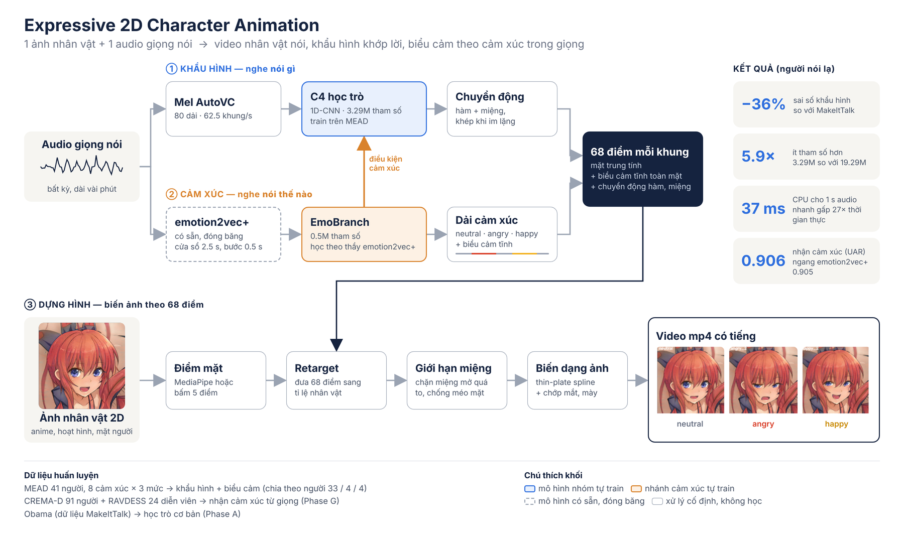
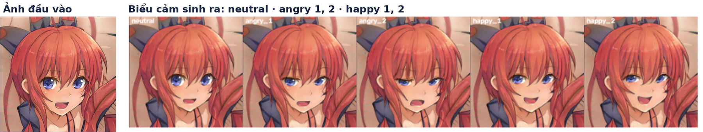
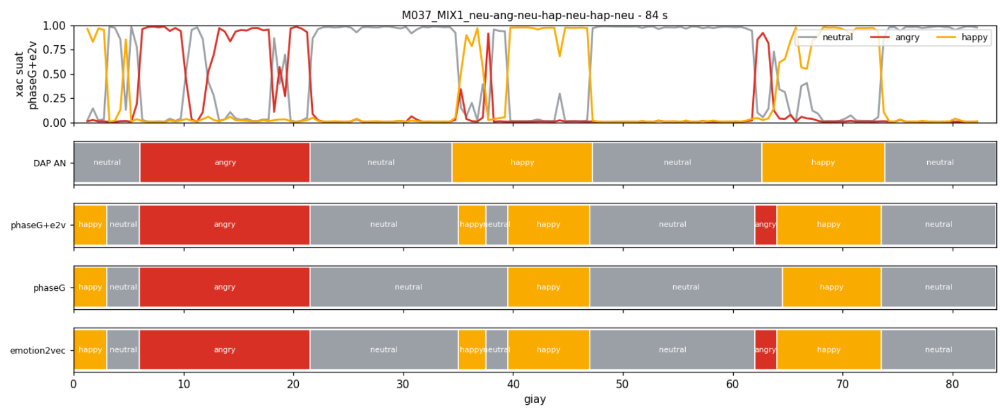
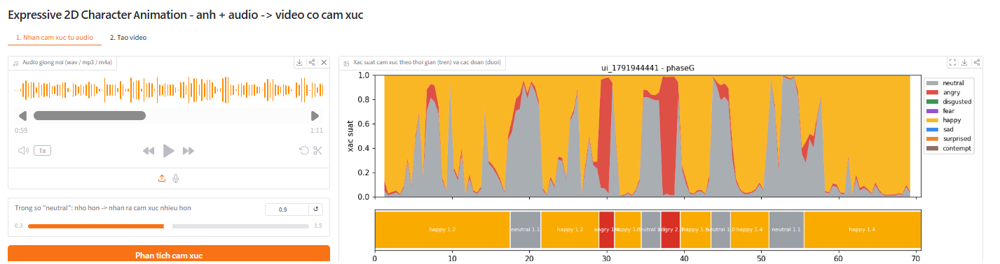
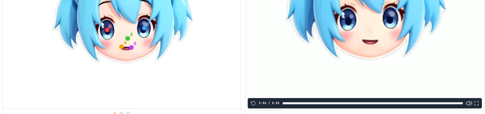

# Expressive 2D Character Animation

**1 ảnh nhân vật 2D + 1 đoạn giọng nói → video nhân vật nói, khẩu hình khớp lời, biểu cảm theo cảm xúc trong giọng.**

Đồ án môn DAT301m. Hệ thống gồm một mô hình khẩu hình nhỏ (3.29M tham số) và một nhánh cảm xúc học trực tiếp từ giọng nói, không cần ai gắn nhãn cảm xúc cho từng câu.



## Kết quả chính

Đo trên 4 người nói chưa từng xuất hiện khi train (bộ MEAD).

| | Mô hình của nhóm (C4) | MakeItTalk gốc |
| --- | --- | --- |
| Sai số khẩu hình toàn mặt (LMD, thấp là tốt) | **0.0414** | 0.0651 |
| Tương quan độ mở miệng với mặt thật | **0.574** | 0.263 |
| Nhận ra đúng cảm xúc trên mặt sinh ra (Emo-Acc) | **0.832** | 0.136 |
| Số tham số | **3.29M** | 19.29M |
| Thời gian cho 1 giây audio | **37 ms CPU · 5.2 ms GPU** | 27.7 ms GPU |

- Biểu cảm học từ giọng nói, không cần nhãn: tốt hơn mốc "đứng yên" **+18.6%** (cách cũ nhận nhãn rồi tra bảng: +15.2%).
- Nhận cảm xúc theo thời gian trên audio ghép nhiều cảm xúc: **UAR 0.906**, bắt đúng **83%** điểm đổi cảm xúc trong ±1 giây, ngang emotion2vec+ (0.905).

| Ảnh đầu vào và biểu cảm sinh ra |
| --- |
|  |

<details>
<summary>Thêm hình: so với MakeItTalk, dải cảm xúc theo thời gian, màn hình demo</summary>








</details>

## Cách hoạt động

Cùng một audio đi qua hai nhánh:

1. **Khẩu hình (nói gì):** audio → mel AutoVC (80 dải, 62.5 khung/giây) → mô hình học trò **C4** (1D-CNN + FC) → chuyển động hàm và miệng.
2. **Cảm xúc (nói thế nào):** audio → **emotion2vec+** (có sẵn, đóng băng, cửa sổ 2.5 s) → **EmoBranch** (0.5M) → cảm xúc neutral / angry / happy theo thời gian và biểu cảm tĩnh toàn mặt. EmoBranch cũng đưa điều kiện cảm xúc vào C4.

Hai nhánh gộp thành 68 điểm mặt mỗi khung, rồi được chuyển sang tỉ lệ khuôn mặt nhân vật, giới hạn độ mở miệng để chống méo, biến dạng ảnh và ghi ra video mp4 có tiếng.

## Cấu trúc repo

```
notebooks/            Notebook Colab, đánh số theo thứ tự chạy
src/models/           model_audio2landmark.py: mô hình học trò StudentAudio2Landmark
src/dataset/utils/    Trung bình / độ lệch chuẩn để chuẩn hoá mel
scripts/              make_aligned.py (căn landmark Obama), check_emotion_pkg.py (kiểm tra gói MEAD)
examples_cartoon/     Ảnh nhân vật mẫu và file điểm mặt (từ MakeItTalk)
facewarp/             Công cụ biến dạng ảnh gốc của MakeItTalk (demo hiện không dùng)
docs/                 Hình minh hoạ cho README
Data_examble/, Data_student/   Thư mục giữ chỗ, mô tả cấu trúc dữ liệu trên Google Drive
```

## Thứ tự chạy

Mọi notebook chạy trên Google Colab. Mỗi notebook tự clone repo này để lấy mô hình, đọc dữ liệu và lưu kết quả lên Google Drive cho bước sau dùng tiếp.

| # | Notebook | Làm gì | Lưu ra (trong `Data_student/student_a2l/`) |
| --- | --- | --- | --- |
| 0a | `0a_stageA_makeittalk_landmarks` | Chạy MakeItTalk gốc lấy landmark theo audio | |
| 0b | `0b_stageB_mead_landmarks` | Trích landmark MEAD bằng MediaPipe FaceLandmarker (478 → 68 điểm), đóng gói theo từng người | `Data_emotion_mead_task_b/stage_b_mead_out/` |
| 1 | `1_phaseA_student` | Train mô hình học trò trên dữ liệu Obama | `phaseA/phaseA_student_best.pth` |
| 2a | `2a_phaseB_prepare_data` | Đổi audio MEAD sang mel, ghép với landmark | `Data_emotion_mead_task_b/phaseB_ready/` |
| 2b | `2b_phaseB_emotion_finetune` | Fine-tune trên MEAD, thêm cảm xúc, chọn **C4** | `phaseB/C4_motion_emo_e20_lr3e4/phaseB_best.pth` |
| 3 | `3_phaseC_demo_render` | **Demo**: render video, màn hình Gradio, đánh giá audio nhiều cảm xúc | `phaseC_demo/` |
| 4 | `4_phaseD_ser_mead` | Thử tự train nhận cảm xúc (SERNet), so với emotion2vec+ | `ser_mead/ser_best.pth` |
| 5 | `5_phaseE_benchmark` | So với MakeItTalk gốc trên 480 clip, đo tốc độ | `phaseE/` |
| 6 | `6_phaseF_emotion_from_audio` | Train EmoBranch (F: 8 cảm xúc, F2: neutral + angry + happy) | `phaseF/phaseF2_final.pth` |
| 7 | `7_phaseG_teacher_student` | EmoBranch học thêm theo "thầy" emotion2vec+ trên CREMA-D, RAVDESS | `phaseF/phaseG_final.pth` |

### Chỉ muốn chạy demo

1. Có sẵn các checkpoint: `phaseB/…/phaseB_best.pth` (C4) và `phaseF/phaseG_final.pth` (hoặc `phaseF2_final.pth`) trên Drive.
2. Mở `notebooks/3_phaseC_demo_render.ipynb` trên Colab (GPU), để `QUICK_UI = True`, chạy từ Cell 0 đến Cell 11.
3. Mở link Gradio: tab 1 phân tích cảm xúc từ audio, tab 2 tải ảnh, bấm 5 điểm trên mặt (hoạt hình) hoặc để MediaPipe tự dò (mặt người), chọn audio và tạo video.

Ảnh đầu vào cho kết quả tốt nhất: nhìn thẳng, miệng khép hoặc hé nhẹ, nền trơn, ảnh từ 512 px trở lên.

## Cài đặt

Trên Colab, mỗi notebook tự cài thư viện cần thiết. Chạy trên máy riêng:

```
pip install -r requirements.txt
```

## Dữ liệu

| Bộ dữ liệu | Dùng cho |
| --- | --- |
| Obama (bản đã xử lý của MakeItTalk) | Phase A |
| [MEAD](https://wywu.github.io/projects/MEAD/MEAD.html): 41 người, 8 cảm xúc × 3 mức | Phase B – G. Chia theo người: 33 train / 4 val / 4 test |
| [CREMA-D](https://github.com/CheyneyComputerScience/CREMA-D): 91 người, chỉ audio | Phase G |
| [RAVDESS](https://zenodo.org/records/1188976): 24 diễn viên, chỉ audio | Phase G |

Dữ liệu và checkpoint không đưa lên Git; chúng nằm trên Google Drive theo cấu trúc `DAT301m/Data_student/…`.

## Hạn chế

- Miệng mở nhỏ hơn thật (biên độ 0.62 so với 1.0) và hơi quá mượt.
- Cảm xúc thể hiện chủ yếu qua biểu cảm tĩnh, chưa vào chuyển động; chưa học được cảm xúc mạnh hay nhẹ.
- Demo chỉ dùng 3 cảm xúc (neutral, angry, happy); không có cử động đầu.
- Chưa có khảo sát người xem (MOS).

## Nguồn và ghi công

- **MakeItTalk** (Zhou và cộng sự, SIGGRAPH Asia 2020): [github.com/yzhou359/MakeItTalk](https://github.com/yzhou359/MakeItTalk). Phần đầu `src/models/model_audio2landmark.py`, `facewarp/`, `examples_cartoon/` và bộ trích mel AutoVC lấy từ đây, theo giấy phép của Adobe (chỉ dùng cho nghiên cứu).
- **emotion2vec+ large** (Ma và cộng sự, 2024), chạy qua [FunASR](https://github.com/modelscope/FunASR): dùng đóng băng làm bộ trích đặc trưng cảm xúc và làm "thầy".
- **MediaPipe** (Google): dò điểm mặt cho MEAD và cho ảnh mặt người trong demo.
- Các bộ dữ liệu MEAD, CREMA-D, RAVDESS thuộc về tác giả gốc; xem giấy phép của từng bộ trước khi dùng.

Phần do nhóm thực hiện: mô hình học trò `StudentAudio2Landmark`, C4, SERNet, EmoBranch, huấn luyện thầy–trò, bộ dựng hình và giới hạn miệng, demo Gradio, toàn bộ quy trình đánh giá.

## Nhóm thực hiện

[Tên thành viên] · DAT301m
