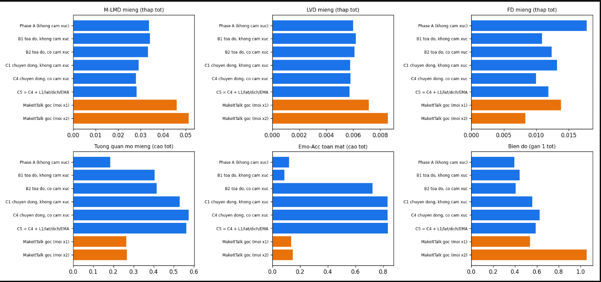

# Expressive 2D Character Animation

**One 2D character image + one speech clip → a talking video with lip sync and facial expressions that follow the emotion in the voice.**

Course project for DAT301m. The system (**ELSA**) combines a small lip-motion model, **LiMoNet** (3.29M parameters), with a speech-emotion branch, **SpEx-KD**, that learns expressions directly from speech, so no one has to label the emotion of each sentence.


## Research goals

Animating talking characters (lecture videos, virtual assistants, games, VTubers) takes a lot of manual work. Published models such as MakeItTalk produce lip motion but no emotion; adding emotion usually requires a manual label for every sentence, and the models are fairly heavy (almost 20 million parameters).

The project sets four goals:

1. **Accurate yet lightweight lip sync:** a model several times smaller than MakeItTalk that still syncs better and runs on a CPU.
2. **Emotion taken from the voice itself:** remove manual emotion labelling.
3. **Follow emotion changes in long audio:** detect when the speaker switches from neutral to angry or happy.
4. **Usable in practice:** any character image (anime, cartoon, human face) + any audio → video, with a demo interface.

Research questions:

- Can a small 1D-CNN replace heavy Transformer / LSTM models for audio-driven lip motion?
- Does separating the static expression (whole sentence) from mouth motion (per sound) help the model learn?
- Can a large pretrained speech-emotion model (emotion2vec+) be reused to generate facial expressions, instead of training from scratch on little data?

Scope: works at the level of 68 facial landmarks followed by image warping, or, for anime characters, redrawing of the mouth, brows and eyelids (no pixel-level generation); 3 emotions in the demo (neutral, angry, happy); no head motion; English speech by actors.

## Main results

Measured on 4 speakers never seen during training (MEAD dataset), on the 480 test clips shared with MakeItTalk.

| | ELSA, true label (reference) | ELSA fully automatic (SpEx-KD + LiMoNet + gain) | Original MakeItTalk |
| --- | --- | --- | --- |
| Full-face landmark error (LMD, lower is better) | 0.0416 | 0.0462 | 0.0651 |
| Mouth-motion error (M-LMD, lower is better) | 0.0291 | 0.0290 | 0.0459 |
| Mouth-opening correlation with the real face | 0.570 | 0.568 | 0.263 |
| Emotion recognisable from the generated face (Emo-Acc, 8 emotions) | 0.829 | 0.307 ¹ | 0.143 |
| Parameters | 3.29M (LiMoNet) | 3.80M trained (+ 164.05M frozen emotion2vec+) | 19.29M |
| Time per 1 s of audio | 41.8 ms CPU · 16.0 ms GPU (LiMoNet) | 607.4 ms CPU · 68.0 ms GPU (whole system) | 27.4 ms GPU |

ELSA, true label (reference) is LiMoNet given the true emotion label of each clip, with the same demo chain and ×1.85 gain; ELSA fully automatic takes only the audio (SpEx-KD predicts the emotion). The whole table comes from one evaluation run, `student_a2l/phaseH/phaseE_demo_chain_with_gain_spex_kd_ci/phaseE_table.md` (same 480 clips, same emotion classifier for Emo-Acc, 95 % CIs there; speed: whole-system table, LiMoNet = the C4 stage), except the MakeItTalk parameter count (19.29M), which that file does not list and comes from `student_a2l/phaseE/phaseE_table.md`.

¹ SpEx-KD only predicts neutral / angry / happy, so on the 8-emotion test set the other 5 emotions cannot be recognised.

- Expressions learned from speech, no labels needed: **+18.6%** better than the "neutral face" baseline (previous approach, classify emotion then look up a table: +15.2%).
- Emotion tracking over time on audio with mixed emotions: **UAR 0.906**, **83%** of emotion changes detected within ±1 s, on par with emotion2vec+ (0.905).

| Input image and generated expressions |
| --- |
|  |

<details>
<summary>More figures: comparison with MakeItTalk, emotion timeline, demo screens</summary>




</details>

## How it works

The same audio goes through two branches:

1. **Lip sync (what is said):** audio → AutoVC mel spectrogram (80 bands, 62.5 frames/s) → **LiMoNet** (checkpoint C4: 1D-CNN + FC) → jaw and mouth motion.
2. **Emotion (how it is said):** audio → **emotion2vec+** (pretrained, frozen, 2.5 s windows, 0.5 s hop) → **SpEx-KD** (EmoBranch distilled from emotion2vec+, `phaseG_final.pth`, 0.5M) → neutral / angry / happy over time plus a static full-face expression. Its probabilities (temperature T = 2) are averaged with emotion2vec+'s own classifier head and decoded with Viterbi into stable segments. SpEx-KD also feeds the emotion condition into LiMoNet.

Both branches are merged into 68 facial landmarks per frame. Mouth motion goes through the demo chain: gain calibration ×1.85 on the mouth–jaw PCA coefficients (before smoothing, `phaseH/mouth_gain.json`), PCA clamp at 2σ, 110 ms Savitzky–Golay smoothing and a silence gate that closes the mouth. The landmarks are then retargeted to the character's face, limited in mouth opening (lip gap ≤ 0.30, chin drop ≤ 0.12 of nose–chin, width ≤ 1.2×, jaw shift ≤ 0.05), used to warp the image (or redraw the face, below), and written to an mp4 video with sound.

On the demo screen the gain calibration is **on by default** (box *Mouth gain x1.85 (paper)* in tab 2, read from `phaseH/mouth_gain.json`; if the file is not on Drive the box is disabled, a warning is printed and the demo renders without it). For notebook rendering it is applied when `MOUTH_GAIN_PATH` in Cell 1 points to `mouth_gain.json`; the default `None` renders without it, as before.

## Repository layout

```
notebooks/            Colab notebooks, numbered in running order
src/models/           model_audio2landmark.py: the StudentAudio2Landmark student model
src/dataset/utils/    Mean / std used to normalise the mel spectrogram
scripts/              make_aligned.py (align Obama landmarks), check_emotion_pkg.py (check MEAD packages)
scripts/mos/          Perceptual (MOS) study: blind video set, baselines, figures, analysis (see its README)
examples_cartoon/     Sample character images and landmark files (from MakeItTalk)
examples_anime/       Three anime characters drawn by the team (SVG + PNG + 11 clicked points), free for research
facewarp/             Original MakeItTalk image-warping tool (not used by the current demo)
docs/                 Figures for this README
Data_examble/, Data_student/   Placeholder folders describing the data layout on Google Drive
```

## Running order

All notebooks run on Google Colab. Each notebook clones this repo to get the model, reads data and saves results to Google Drive for the next step.

| # | Notebook | What it does | Output (in `Data_student/student_a2l/`) |
| --- | --- | --- | --- |
| 0a | `0a_stageA_makeittalk_landmarks` | Run the original MakeItTalk to obtain audio-driven landmarks | |
| 0b | `0b_stageB_mead_landmarks` | Extract MEAD landmarks with MediaPipe FaceLandmarker (478 → 68 points), packaged per actor | `Data_emotion_mead_task_b/stage_b_mead_out/` |
| 1 | `1_phaseA_student` | Train the student model on Obama data | `phaseA/phaseA_student_best.pth` |
| 2a | `2a_phaseB_prepare_data` | Convert MEAD audio to mel and pair it with landmarks | `Data_emotion_mead_task_b/phaseB_ready/` |
| 2b | `2b_phaseB_emotion_finetune` | Fine-tune on MEAD with emotion input, select **LiMoNet (C4)** | `phaseB/C4_motion_emo_e20_lr3e4/phaseB_best.pth` |
| 3 | `3_phaseC_demo_render` | **Demo**: render video, Gradio interface, evaluation on mixed-emotion audio | `phaseC_demo/` |
| 4 | `4_phaseD_ser_mead` | Train our own speech-emotion model (SERNet) and compare with emotion2vec+ | `ser_mead/ser_best.pth` |
| 5 | `5_phaseE_benchmark` | Compare with the original MakeItTalk on 480 clips, measure speed | `phaseE/` |
| 6 | `6_phaseF_emotion_from_audio` | Train EmoBranch (F: 8 emotions, F2: neutral + angry + happy) | `phaseF/phaseF2_final.pth` |
| 7 | `7_phaseG_teacher_student` | **SpEx-KD**: further train EmoBranch with emotion2vec+ as teacher on CREMA-D and RAVDESS | `phaseF/phaseG_final.pth` |
| 8 | `8_phaseH_mouth_amplitude` | Mouth-amplitude calibration of LiMoNet (gain ×1.85, chosen on VAL) | `phaseH/mouth_gain.json` |

### Running only the demo

1. Have the checkpoints on Drive: `phaseB/…/phaseB_best.pth` (LiMoNet, C4) and `phaseF/phaseG_final.pth` (SpEx-KD; falls back to `phaseF2_final.pth`).
2. Open `notebooks/3_phaseC_demo_render.ipynb` on Colab (GPU), keep `QUICK_UI = True`, and run Cell 0 to Cell 11. The demo screen uses the paper configuration by default (mouth gain ×1.85 and, for anime, redrawing); for notebook rendering set `MOUTH_GAIN_PATH` to `phaseH/mouth_gain.json` in Cell 1.
3. Open the Gradio link: tab 1 analyses emotion in an audio clip; tab 2 takes a sample character (e.g. `anime_girl`, `anime_boy`, `anime_girl2`, no clicking needed) or a new image with clicked face points (cartoon: 5 for warping, 11 with redrawing, see below) or MediaPipe auto-detection (human face), and an audio clip, then renders the video.

Best input images: frontal face, mouth closed or slightly open, plain background, at least 512 px.

## Redrawing renderer for anime

Warping alone stretches a small anime mouth and cannot show blinks or emotional eyelids on large anime eyes, so for anime characters the demo can **redraw** the mouth, brows and eyelids on top of the warped image instead. The motion still comes from the same landmarks (LiMoNet + the demo chain); only the drawing changes.

- **Mouth:** the original mouth is removed and a new one is drawn from the lip gap and width of each frame (closed line, slightly open, open, wide open, round); opening is scaled by `MOUTH_REDRAW_OPEN_SCALE = 1.2`, and only happy / angry segments may open wide.
- **Eyes:** blinks at random intervals of 3–5 s (about 0.18 s each, fixed seed), angry eyelid slanting down towards the nose (28 % of the eye height at the inner corner, 7 % at the outer), happy squint up to 35 % of the eye height only at the highest happy level with the mouth at least 1.15× its resting width. The eyes are redrawn whenever mouth or brow redrawing is on.
- **Brows:** follow the emotion (angry ≈ 17° and 1.3× thicker, happy raised, sad raised at the inner end) plus a small motion from the brow landmarks.

**11 clicked points** (in this order): left eye, right eye, nose tip, left mouth corner, right mouth corner (these 5 are enough for warping), then the middle of the upper lip and the middle of the lower lip (mouth redraw), then the outer and inner end of the left brow and the inner and outer end of the right brow (brow redraw).

**Sample anime characters.** `examples_anime/` holds three characters drawn by the team as SVG (`anime_girl`, `boy`, `girl2`; in the demo list as `anime_girl`, `anime_boy`, `anime_girl2`, because MakeItTalk already has a `boy`), each with a 1024 px PNG and `<name>_points.json` holding the 11 points. They are free to use for research. Picking one in the demo loads its 11 points automatically, so no clicking is needed.

**Turning it on and off**

- Demo screen (tab 2): the *Mouth redraw (anime)* and *Brow redraw (anime)* boxes are **ticked by default for anime** (a newly uploaded image, the three sample anime characters, or `danbooru1`) and unticked for the other sample characters; untick them to get plain warping. For a new image, tick them before clicking the points so the hint asks for all 11. The defaults are set by `UI_REDRAW_ANIME` / `UI_ANIME_CHARS` in Cell 11.
- Notebook rendering: `MOUTH_REDRAW` and `BROW_REDRAW` in Cell 1 (both `False` by default), or `render(..., mouth_redraw=True, brow_redraw=True)`. Fine-tuning: `MOUTH_REDRAW_CFG`, `BROW_REDRAW_CFG`, `EYE_REDRAW_CFG`.
- With every flag off the output is bit-identical to the warping-only demo (commit `982093d`).

## Perceptual study

The blind MOS study (S1 ELSA full, S2 ELSA warp only, S3 MakeItTalk landmarks through the same redraw renderer, S4 Wav2Lip; 3 anime characters, 12 MEAD sentences, attention checks), the scripts that build it, the paper figures and the analysis script `mos_analyze.py` are described in [scripts/mos/README.md](scripts/mos/README.md). Videos and the answer key are kept outside the repository.

## Installation

On Colab, each notebook installs what it needs. To run locally:

```
pip install -r requirements.txt
```

## Data, checkpoints and results (Google Drive)

Code comes straight from this repo (each notebook clones it when it runs). Only the [**Data_student**](https://drive.google.com/drive/folders/1uYDtQQwLglkdYr9iEFueLsjZFlQ50ZtI) folder is shared on Google Drive: processed data, checkpoints and the results of every phase.

To re-run the notebooks:

1. Open the **Data_student** link, choose **Add shortcut to Drive**, and place the shortcut in `MyDrive`.
2. Open a notebook on Colab. Cell 0 finds the `Data_student` folder through the shortcut. If it picks the wrong folder, set `DRIVE_ROOT_OVERRIDE`, e.g. `/content/drive/MyDrive/Data_student`.
3. Notebooks `1_phaseA_student` and `2b_phaseB_emotion_finetune` contain the fixed path `/content/drive/MyDrive/DAT301m/Data_student`; change it to your shortcut path before running.

| Folder in `Data_student` | Contents |
| --- | --- |
| [Data_maketalk_landmard_task_a](https://drive.google.com/drive/folders/17Bi8fdauuQrj-fZvjWkDoLqatpxnUfiC) | Obama data for Phase A (mel + landmarks) |
| [Data_emotion_mead_task_b](https://drive.google.com/drive/folders/1jOxdzWDUUwrhM4LKRvLPYvWXFa-7L2GL) | MEAD landmarks (Stage B), `phaseB_ready` data, emotion2vec+ features |
| [student_a2l](https://drive.google.com/drive/folders/1oBZb5C32npb5anWjR0TKRbj8qZSPxwkV) | Checkpoints and outputs of each phase: |
| &nbsp;&nbsp;&nbsp;├ [phaseA](https://drive.google.com/drive/folders/1-gQP-sTU01kVVNVyqmGVxi03kBZEhhBl) | Student model, loss curves, evaluation tables |
| &nbsp;&nbsp;&nbsp;├ [phaseB](https://drive.google.com/drive/folders/1pBrX8Onwr7LK_vaXeqhRAcKOqs_Bb11t) | C4 and variants B1–C5, `phaseB_evaluation.json` |
| &nbsp;&nbsp;&nbsp;├ [phaseC_demo](https://drive.google.com/drive/folders/1TdcXdMUlZ4H05YBENzazcVA6kqRJ_7C0) | Demo videos, expression images, mixed-emotion evaluation figures |
| &nbsp;&nbsp;&nbsp;├ [ser_mead](https://drive.google.com/drive/folders/1H3y1Oj-JLSVIBbnG8s4qKjjiAKVBkUvH) | SERNet (Phase D), confusion matrix |
| &nbsp;&nbsp;&nbsp;├ [phaseE](https://drive.google.com/drive/folders/1ak3VCYX6LDk4wNouj93cSo2_gDIR4GZU) | Tables and charts comparing with MakeItTalk |
| &nbsp;&nbsp;&nbsp;├ [phaseF](https://drive.google.com/drive/folders/1K4xQSkgzU36xo3tlWaOuPOpFCbFyCnj-) | EmoBranch: `phaseF2_final.pth`, `phaseG_final.pth`, evaluation tables |
| &nbsp;&nbsp;&nbsp;└ [makeittalk_ckpt](https://drive.google.com/drive/folders/1L8QaVQVoTaC9Hw3SCQsu2UrK__itdoFe) | Original MakeItTalk checkpoints used for comparison |

The original MEAD, CREMA-D and RAVDESS data are not redistributed here; download them from the authors' pages (table below).

## Datasets

| Dataset | Used for |
| --- | --- |
| Obama (preprocessed release from MakeItTalk) | Phase A |
| [MEAD](https://wywu.github.io/projects/MEAD/MEAD.html): 41 speakers, 8 emotions × 3 intensities | Phases B – G. Split by speaker: 33 train / 4 val / 4 test |
| [CREMA-D](https://github.com/CheyneyComputerScience/CREMA-D): 91 speakers, audio only | Phase G |
| [RAVDESS](https://zenodo.org/records/1188976): 24 actors, audio only | Phase G |

Data and checkpoints are not stored in Git; see the Google Drive section above.

## Limitations

- LiMoNet's raw mouth opens less than in reality (amplitude ratio 0.62 vs 1.0) and motion is somewhat over-smoothed; the ×1.85 gain calibration compensates the amplitude but not the timing.
- Emotion is expressed mainly through the static expression, not yet through motion; emotion intensity is not learned.
- The demo uses only 3 emotions (neutral, angry, happy); no head motion.
- The redrawing renderer is designed for anime faces; on other styles use plain warping.
- Perceptual study: see [scripts/mos](scripts/mos/README.md).

## Credits and licences

- **MakeItTalk** (Zhou et al., SIGGRAPH Asia 2020): [github.com/yzhou359/MakeItTalk](https://github.com/yzhou359/MakeItTalk). The first part of `src/models/model_audio2landmark.py`, `facewarp/`, `examples_cartoon/` and the AutoVC mel extractor come from this project, under Adobe's licence (research use only).
- **emotion2vec+ large** (Ma et al., 2024), run through [FunASR](https://github.com/modelscope/FunASR): used frozen as the emotion feature extractor and as the teacher.
- **MediaPipe** (Google): facial landmark detection for MEAD and for human-face images in the demo.
- MEAD, CREMA-D and RAVDESS belong to their original authors; check each dataset's licence before use.

Developed by the team: the `StudentAudio2Landmark` student model, LiMoNet (C4), SERNet, EmoBranch and SpEx-KD (teacher–student training), the mouth gain calibration, the rendering pipeline with mouth limits and the anime redrawing renderer, the Gradio demo, the MOS study, and the full evaluation protocol.

## Team

- **Vũ Thị Thu Hiền**: main author (model design, training, evaluation, demo, report).
- With support from the other team members.

DAT301m course project.
